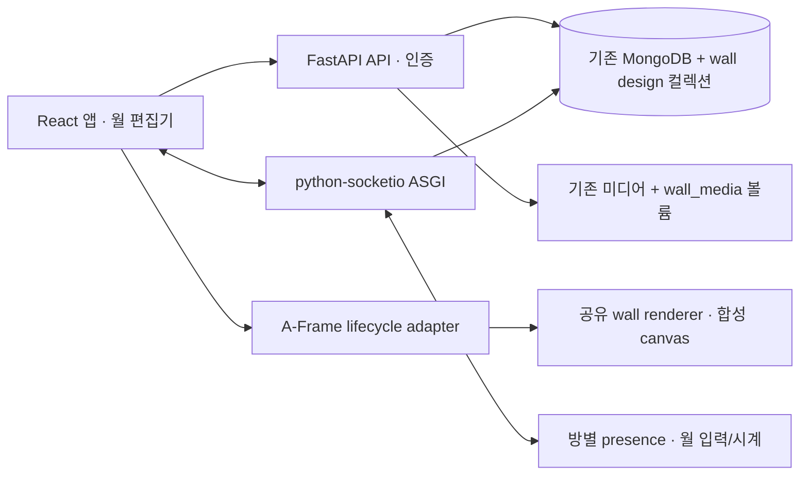

# FastAPI · React · 공유 인터랙티브 월 전환 설계

상태: 사용자 검토용 제안. 제품 구현 전 단계.
날짜: 2026-10-29 (Asia/Seoul)
브랜치: `codex/fastapi-react-interactive-walls`
기준 커밋: `974bbfd74ecd9a1330a03d7dd2a19994209ec8f5` (`origin/master`)

## 1. 사용자 요구와 확정한 내용

- Flask 백엔드를 FastAPI로 전면 교체한다.
- 프런트엔드와 웹 UI를 현대화하면서 기존 서비스 기능을 유지한다. React는 사용자가 제시한 후보이며, React + TypeScript + Vite 채택은 이 설계의 권장안이다.
- `sebaram/gsmv-interactive-bg`의 제작 기능을 가져와 기존 갤러리의 월 하나를 디자인하고 적용한다.
- `mvbg.arrc.app`과 같은 프리셋 라이브러리를 제공하고 이 프로젝트의 MongoDB에 저장한다.
- **같은 방의 모든 방문자에게 월의 상호작용 반응을 실시간으로 공유한다.** 사용자가 2026-10-29에 선택한 요구이다.
- 별도 브랜치에서 단계별로 구현하며, 서브에이전트 구현·리뷰·디버깅과 실제 브라우저 테스트를 수행한다.

이번 문서는 사전 조사와 구현 범위 제안이다. 운영 배포는 이 요청에 포함된 실행 단계로 간주하지 않는다.

## 2. 조사 결과와 현재 기준선

직접 실행한 JavaScript 테스트: **125 passed, 0 failed** (`node --test tests/js/*.test.mjs`). Python 통합 테스트와 브라우저 E2E는 아직 실행하지 않았다.

로컬 Docker Engine 29.5.3이 실행 중이다. MongoDB 컨테이너는 없으며 기존 MariaDB/Postgres 컨테이너는 이 작업과 무관하다. Node 26.10.0/npm 11.19.1이 있고 번들 Python 3.12.14는 사용할 수 있지만 백엔드 패키지는 설치돼 있지 않다. 구현 단계에서 프로젝트 전용 가상환경과 격리된 MongoDB를 준비한다.

최근 GitHub Actions 실행 `40257231769`는 기준 커밋의 빌드·Mongo 통합 테스트·배포에 성공했고 self-hosted runner는 online이다. 현재 workflow는 master push/수동 실행만 처리하며 Node/브라우저 테스트는 없다.

실제 모델의 작품 유형은 Image, GaussianSplat, GLTFmodel, Webpage이다. 영상은 별도 Video 모델이 아니라 `Wall.video_url`이다. 기존 `LocationPreset`은 카메라 위치/회전/기본 스폰용이다.

### 보존해야 할 서비스 표면

| 범위 | 현재 경로/소스 | 전환 후 기준 |
|---|---|---|
| 공개 탐색 | `/`, `/room?room_id=`, `/wall?wall_id=`, `/element?wall_element_id=&type=` | 기존 딥링크/QR/쿼리 유지, 카탈로그와 상세 UI 교체 |
| 방 컨트롤 | `static/js/room/` | 이동·경계·미니맵·텔레포트·QR·선택적 프로필 UI 유지 |
| 방문자 | `core/visitor_capability.py`, `visitor-session.js` | 탭별 capability, reload 유지, 새 탭 구분, `user=new`, 게스트 DB 레코드 생성 금지 |
| 실시간 | `core/position_sync.py`, `presence_service.py` | 위치/손/표정/프로필/재접속/중복 연결 처리와 기존 event/payload 유지 |
| 인증 | `/signin`, `/logout`, `/confirm/<token>`, `/protected`, `/register` | 기존 계정·bcrypt·확인 토큰 유지, 신규 가입 폐쇄 유지 |
| 관리 | `/kwanri`, `metamuseum/__init__.py` | 아래 11종 CRUD와 관계 편집을 React로 대체 |
| 작품/월 편집 | `elements/basic.py`, `main_views.py` | 선택한 작품의 위치·크기·회전·소스 편집, 월/바닥/천장 좌표 보존 |
| 미디어 | `/stream/*`, `core/streaming.py` | RTSP→HLS, 폰 업로드, 실제 플레이어, 시작/정지/정리 |
| AI | `views/llm_layout.py`, `whisper_views.py` | 레이아웃 제안/적용·효과·설정·음성 인식·자막, 비밀키 비노출 |
| AR | `/room?...&ar=marker`, `/room?...&ar=companion`, `/ar-companion` | 마커·폰 송신·수신·연결 상태와 방 격리 |
| 실험 도구 | `/gesture-mark/*` | gesture/touchpoint HTTP·Socket.IO·SSE 경로와 도구 화면 유지 |
| 미디어 URL | `/static/image`, `/static/splat`, `/static/gltf`, `/stream` | 기존 DB가 참조하는 URL/호스트 볼륨 경로 유지 |

관리 대상 11종: Room, Wall, Image, GaussianSplat, GLTFmodel, Webpage, LocationPreset, RoomEffect, Marker, LLMConfig, WhisperConfig. 현재 등록되지 않은 User CRUD나 과거의 미등록 데모 템플릿은 새 기능으로 확장하지 않는다.

### 조사에서 발견한 결함도 인수 기준에 포함

단순히 템플릿을 새 UI로 옮겼다는 이유로 기능 보존 완료를 선언하지 않는다.

- inspector가 첫 작품만 선택하는 문제, 드래그 좌표와 SPA 재진입 시 listener/socket/timer 누수를 수정한다.
- Wall.image_url 렌더링, 실제 HLS 초기화와 segment URL, 녹화 MIME 협상, 폰 영상 변환을 검증한다.
- LLM 적용의 월 간 작품 이동/역방향 참조, 효과의 JSON 타입·초기 조회·만료 처리, 일반 방문자의 STT 활성화 상태 조회를 수정한다.
- Gaussian cutout은 지원하는 clipping 구현과 로컬 splat fixture로 확인한다. 구현할 수 없으면 이 기능은 미완료로 기록하고 전체 동등성 완료를 주장하지 않는다.
- Webpage는 허용된 페이지에 대해 2D DOM overlay/플레이어를 제공한다. 임의 외부 iframe의 3D 텍스처/XR 합성은 보장하지 않으며, 차단된 페이지에는 URL 열기와 명확한 상태를 제공한다.
- 새 로그인은 폼 검증·CSRF·안전한 redirect를 적용하고 비밀번호/폼 로그를 남기지 않는다.

## 3. 권장 구조와 대안

권장안은 FastAPI + React UI + 기존 A-Frame 렌더러를 명시적인 lifecycle adapter로 감싸는 구조이다. React Three Fiber로 3D를 동시에 다시 작성하는 대안은 WebXR/AR/위치 보간/미디어 검증 범위를 크게 늘린다. React를 Jinja 위에 일부만 붙이는 대안은 최종 Flask 제거와 관리 화면 교체를 충족하지 못한다.

- 백엔드는 `backend/metamuseum/`, 프런트엔드는 `frontend/`에 구성한다. 전환 중 기존 `flask_server/`는 회귀 비교용으로 유지하고 마지막 단계에서 런타임 의존을 제거한다.
- 회귀 인수가 끝나면 사용 중인 assets와 서비스 로직을 새 위치로 옮기고 대체된 Flask 코드/설정/시작 스크립트는 제거한다. 비교용 원본은 Git 이력과 계약 fixture로 남긴다.
- FastAPI와 `python-socketio.AsyncServer`를 하나의 ASGI 앱으로 묶어 Uvicorn **1 worker**로 실행한다. 기존 인메모리 presence/AR/voice/gesture/FFmpeg 상태를 유지하는 조건이다. Redis/다중 worker 확장은 별도 작업이다.
- MongoEngine의 기존 스키마를 우선 유지한다. Flask UserMixin/url_for/extension 의존은 제거하고, sync DB 코드는 HTTP의 threadpool 또는 socket handler의 명시적 offload로 실행한다.
- 최종 프로세스는 Flask, Flask-Admin, Flask-SocketIO, eventlet을 사용하지 않는다. WSGI mount는 전환 중 실험 수단일 수 있어도 최종 인수 조건을 충족하지 않는다.
- React는 화면/접근성/폼/편집 draft를 소유하고 A-Frame은 scene graph와 frame loop를 소유한다. pose마다 React re-render를 유발하지 않는다.
- `mountRoom({container, bootstrap, services}) -> {update, dispose}` 경계를 만든다. `dispose`는 socket, XR, media track, listener, RAF, texture, WebGL context, timer를 해당 인스턴스 범위에서 해제한다.
- JSON DTO로 씬을 구성하고 서버의 HTML 문자열을 `dangerouslySetInnerHTML`로 삽입하지 않는다.
- 배포는 FastAPI가 빌드한 React assets를 동일 origin으로 제공한다. 개발 Vite proxy는 API/Socket.IO polling·WebSocket/streams/기존 URL을 모두 전달한다.

근거: [FastAPI concurrency](https://fastapi.tiangolo.com/async/), [Socket.IO ASGI](https://python-socketio.readthedocs.io/en/stable/server.html), [Vite integration](https://vite.dev/guide/backend-integration), [React external lifecycle](https://react.dev/reference/react/useEffect).

## 4. DB와 인증 호환성

기존 BSON ObjectId, 실제 collection 이름, `_cls`, ReferenceField/DBRef 표현, 리스트 순서, 양방향 관계, 기본값과 vector 문자열/숫자 필드를 유지한다. `users`, `llm_configs`, `whisper_configs` 외 collection 이름도 모델 metadata로 캡처해 계약 fixture에 고정한다.

기존 production Mongo는 외부 `tlx-mongo_default` 네트워크의 장기 실행 DB이다. 테스트는 전용 compose 프로젝트의 `metamuseum_test`만 사용한다. destructive fixture는 DB 이름과 test-instance marker를 모두 확인한다. 운영에서 `seed_data.py`를 실행하지 않는다. 이 스크립트는 기존 데이터를 삭제한다.

커밋할 golden fixtures는 synthetic/sanitized 데이터로 만든다. 운영 dump, 실제 비밀번호 해시/비밀키/사용자 정보는 저장소나 테스트 artifact에 넣지 않는다. dump/restore 리허설 자료는 접근을 제한한 별도 로컬 저장소에 둔다.

기존 계정과 해시는 그대로 사용하고 새 signed HttpOnly/SameSite 세션을 발급한다. **관리자는 전환 시 한 번 다시 로그인하는 것**을 권장 기본값으로 둔다. 기존 Flask 로그인 쿠키까지 이어받는 호환 decoder는 기본 범위에 넣지 않는다. visitor/confirmation 토큰은 기존 secret/salt/형식을 유지한다.

API와 관리 socket 동작에 동일한 administrator 판단을 사용한다. origin 검증과 CSRF를 적용한다. AR/gesture 기존 연결은 별도 handshake 프로필로 보존하되, 방문자 presence나 새 월 입력 권한을 주지는 않는다.

## 5. 새 UI와 편집 흐름

- 공개 화면: 갤러리 카탈로그, 방 viewer, 월 display, 작품 상세, 로그인, AR companion, 실험 도구.
- 관리자 화면: 방/월/작품 계층, 중앙 stage와 3D preview, 선택 항목 inspector, 미디어/효과/마커/스폰/서비스 설정.
- 월 디자인 화면: 좌측 layer/preset 목록, 중앙 월 비율 stage, 우측 속성, 저장/복제/되돌리기/적용 상태.
- 선택·드래그·키보드 nudge·숫자 입력이 동일 draft를 수정한다. 저장 실패 시 draft를 유지하고 재시도 가능하게 한다.
- AI 레이아웃은 draft preview 후 명시적 적용으로 바꾼다. 월 간 이동은 관계 리스트와 작품 wall 참조를 함께 갱신한다.
- 프리셋 **저장**과 월에 **적용**을 분리한다. 다른 월에서 사용하는 프리셋을 편집해도 이미 적용된 화면을 바꾸지 않는다.
- 원본 디자인을 그대로 복사할 수 있게 reference 브랜드/레이어 정보를 보존하되 앱 자체 기본 문구는 프로젝트에 맞춘다. UI 문구는 우선 한국어로 통일하고 기존 콘텐츠의 언어는 보존한다. 국제화 프레임워크는 이번 범위에 추가하지 않는다.

## 6. 인터랙티브 월 엔진과 참고 기능

참고 소스는 `b247fd238fe6cb2c8c860c77d13488b28b8a0290`에 고정한다. [소스](https://github.com/sebaram/gsmv-interactive-bg/tree/b247fd238fe6cb2c8c860c77d13488b28b8a0290).

소스의 12 built-in과 Astra 16종/Meaning 16종 JSON을 초기 Mongo 카탈로그로 가져온다. source key로 반복 import를 멱등하게 하며 기본 항목은 복제해서 사용자 프리셋으로 편집한다. live demo의 서버 저장 프로젝트는 조사 시 0개였으므로 공개 preset 카드와 사용자 저장 레코드를 혼동하지 않는다.

12 built-in: Blue Hour, Common Ground, Soft Architecture, Living Research, Shared Reality, MV Symbiosis, Serein Atelier, MV Light Court, Co-presence, Shared coordinates, Mutual response, Co-creation.

기능 범위는 preset browser, layer 검색/그룹/재그룹/정렬/복제/삭제/visibility, undo/redo, keyboard/context menu, 위치·균일 크기·평면 회전, 객체별 motion/seed, rich text, MV/ribbon/orbit/network/sphere/arch/research 오브젝트, gradient/solid/glow/lighting/floor/brightness, 영상 layer를 포함한다. 입력 schema는 원본의 32 custom objects, 4096 edits, 8 screens, 8 videos 한도를 유지하되, 이 앱의 월 하나에는 **선택한 한 logical screen**을 월 비율에 맞춰 표시한다.

원본의 WebGL 외부 DOM text/logo/video와 CSS brightness를 합성 canvas/texture layer로 옮긴다. `look-thumbnail.js`는 구성 참고이며 매 frame DOM screenshot을 찍는 방법은 사용하지 않는다. standalone 월과 room의 월 표면은 동일 엔진을 사용한다.

`createWallRenderer({canvas, config, assetResolver, onError})`는 `setConfig`, `resize`, `setInteraction`, `render(timeSeconds)`, `dispose`를 제공한다. RAF와 공유 시각은 바깥 adapter가 소유한다. renderer는 window 크기/localStorage/URL/global singleton에 의존하지 않는다. 원본 Three.js와 A-Frame의 Three.js 객체를 섞지 않고 canvas 경계로 연결한다.

월 크기·위치·회전·기존 작품은 적용 시 보존한다. 새 look 프리셋은 배경과 장식 구성을 저장하며 기존 작품의 ID/배치를 복제하지 않는다. 작품 배치는 기존 편집 기능으로 관리한다.

적용된 binding은 기존 `Wall.image_url`/`video_url` 배경보다 우선한다. 원래 필드는 DB에서 보존하고, binding이 활성화된 동안 원래 배경 영상은 재생/디코딩을 멈춘다. binding 제거 시 기존 배경으로 복귀하며 월 위에 배치된 작품은 계속 유지한다. 이 우선순위는 설계에서 선택한 기본값이다.

### 구현 전 확인해야 할 합성 제약

업로드 또는 CORS가 허용된 직접 영상은 실제 frame을 texture로 표시한다. **YouTube iframe은 canvas에 합성할 수 없다.** 권장 지원은 3D 월의 poster/열기 control + 동기화된 2D 플레이어이고, 일반 2D display에서는 iframe player를 유지하는 것이다. YouTube를 몰입형 월 자체에 재생해야 한다면 대체 원본 영상 확보/지원 범위를 사용자와 확정해야 한다. 자동 성공으로 처리하거나 브라우저 보안을 우회하지 않는다.

동일한 제약은 임의 외부 Webpage에도 적용된다. 첫 renderer 검증은 animated artwork + text + logo + 업로드 영상 + brightness가 편집기/월 display/room에서 일치하는지 확인한다. 이 검증을 통과하기 전에 전체 layer UI를 병렬 확장하지 않는다.

### 설계 리뷰에서 남은 사용자 확인

1. YouTube를 poster/별도 2D 플레이어로 제공하는 권장안을 허용할지, 월 표면 재생이 필수인지 확인 중이다.
2. 공유 범위에 영상 playback position/pause/seek를 포함할지 확인 중이다. 포인터와 그래픽 애니메이션 공유는 이미 확정됐다. 영상까지 포함하면 binding에 canonical playback clock을 추가하고 관리자만 play/pause/seek를 변경하며 late join도 해당 위치로 복원하는 안을 권장한다. 소리 켜기는 각 장치의 브라우저 허용/사용자 동작을 따른다.

이 두 항목은 질의를 보냈으며 승인/답변이 오지 않은 상태를 확정 요구로 표시하지 않는다. 나머지 계약/데이터/인증/화면 작업과는 독립적으로 검토할 수 있다.

## 7. MongoDB 프리셋 저장 계약

| 새 collection | 내용 |
|---|---|
| `wall_design_presets` | name, schema_version=1, renderer_version/source_commit, source_key, revision, validated config, asset_ids, thumbnail_asset_id, timestamps |
| `wall_design_bindings` | unique wall_id, room_id, binding revision, preset_id/revision, 적용된 config snapshot, asset_ids, logical_screen, seed, animation_epoch_ms |
| `wall_design_assets` | id, name, generated relative path, MIME, size/hash, dimensions/duration, uploader, timestamps, upload status |

기존 Wall 문서에 필수 필드를 추가하지 않고 binding을 별도 조회해 기존 데이터/rollback 호환성을 지킨다. 프리셋 config는 원본 variant/authored stable ID를 유지하면서 JSON schema로 검증한다. 선택/clipboard/undo stack은 DB에 저장하지 않는다.

저장/수정/삭제/적용/업로드는 기존 관리자만 가능하다. 공개 방문자는 적용된 config와 필요한 assets를 읽고 방에 참여해 상호작용할 수 있다. 수정/적용에 expected revision을 요구하고 stale save는 409로 응답한다. 삭제된 프리셋의 기존 적용 snapshot은 계속 작동한다. preset 또는 binding이 참조하는 asset은 삭제를 거절한다.

JSON/메타데이터는 MongoDB에 저장한다. 영상 등의 큰 binary는 기존 배포 방식에 맞춰 `/var/www/metamuseum/data/wall_media` 영구 볼륨에 두고 Mongo의 asset ID로 참조한다. browser blob URL은 저장할 수 없으며 upload 완료 뒤 영구 asset ID로 변환한다. 초기 한도는 reference와 같은 파일당 2 GiB/전체 20 GiB를 설정값으로 두고 streaming upload·MIME 검사·총량/경로/참조 검증을 적용한다. JSON import/export와 thumbnail 생성도 제공한다.

## 8. 같은 방에서 공유하는 실시간 반응

디자인 저장과 월 적용은 durable Mongo 상태, 포인터 입력은 runtime 상태로 구분한다. 서버 재시작 후 디자인/seed/animation epoch는 복구하고 이전 포인터는 중앙으로 초기화한다.

renderer 원본의 반응은 pointer tilt이다. 마이크/손 AI 반응 기능이 있다고 가정하지 않는다. mouse/touch와 XR ray hit를 월 UV로 변환해 동일 입력으로 전달한다. 원본 normalized 좌표는 `x = u - 0.5`, `y = 0.5 - v` (UV v는 위가 1, y는 아래가 양수)로 고정하고 test로 방향을 검증한다.

- client→server `wall.interaction`: `{wall_id, binding_revision, client_seq, kind: move|leave, uv?: {u,v}}`.
- server→room `wall.interaction_state`: `{wall_id, binding_revision, runtime_id, sequence, server_time_ms, pointer: {x,y}, seed, animation_epoch_ms, active_until_ms}`.
- join/reconnect는 적용 snapshot과 interaction state를 받는다. `runtime_id`는 프로세스 재시작을 구분하고 sequence는 wall 단위로 증가한다.
- 서버는 capability와 실제 room membership, wall 소속, interactive 활성화, revision, finite 숫자/UV [0,1]을 확인한다. 다른 방 입력은 거부한다.
- 한 월의 공용 pointer는 서버가 마지막으로 승인한 입력을 따른다. 여러 사람이 동시에 입력하면 서버 순서로 마지막 입력이 이긴다. reference의 단일 pointer 모델을 유지하는 설계상 기본값이다.
- pointer client 전송은 최대 20 Hz, 서버 broadcast도 월당 최대 20 Hz로 coalesce한다. 무제한 queue를 만들지 않는다. 3초 입력 부재 또는 active visitor의 leave/disconnect 시 중앙으로 복귀한다.
- random은 저장 seed에서 생성하고 animation/smoothing은 공유 epoch와 서버 시계 추정에 기반한다. local RAF delta 누적으로 방문자별 애니메이션 위상이 달라지지 않게 한다.
- 송신 방문자도 authoritative state를 적용한다. 네트워크 지연 후 같은 상태로 수렴해야 하며 모든 장치의 pixel/frame 자체가 동일하다는 조건은 아니다.
- config apply는 `wall.design_applied`로 room에 알리고 해당 wall revision/interaction을 전환한다. 다른 방에는 전파하지 않는다.

기존 위치 동기화의 최대 20 Hz, 정지 heartbeat 1초, 보간 지연 100 ms, buffer 8개는 유지한다.

## 9. 검증과 완료 기준

1. 실제 MongoDB로 HTTP/Socket.IO 통합 테스트를 한다. 운영 DB를 사용하지 않는다.
2. Playwright는 실제 ASGI/React/Socket.IO를 사용한다. 핵심 API를 page.route로 가려서 통과시키지 않는다. LLM/STT/메일 등 외부 서비스만 로컬 fixture 서버로 대체한다.
3. fixture는 실제 bcrypt 비밀번호의 관리자/비관리자, 모든 작품 유형, rotated wall/floor/ceiling, local image/GLB/splat/MP4/HLS, frame 허용/차단 HTML, marker/effects/spawn을 제공한다.
4. Chromium 전체 E2E, Firefox/WebKit smoke, 모바일 touch/fine pointer, 키보드/접근성, reload/deep link, 저장 실패/409를 확인한다.
5. 같은 browser context의 여러 탭으로 visitor 분리/복사 탭/reload를 검증하고, 다른 context의 관리자·방문자로 권한을 검증한다.
6. 공유 월은 두 방문자 입력 수렴, 지연·역순·재접속·late join, 다른 방 차단, concurrent input, apply revision 변경, rate/idle reset, 서버 재시작 후 durable 복원을 확인한다.
7. 원본 44종 import를 반복해 중복이 없고, 생성/복제/수정/JSON export/import/적용/재시작/reload 후 동일한 look이 복원돼야 한다.
8. 브라우저 console/pageerror/실패한 핵심 network request, WebGL context loss, texture/video 로드 실패를 기록한다. 실패 시 screenshot/trace를 보존한다.
9. desktop에서 한 animated wall의 compositor는 30 FPS 목표, mobile은 24 FPS 목표로 실기 측정한다. scene 전환 10회 후 socket/listener/track/context가 계속 증가하지 않아야 한다. headless 결과를 실제 GPU 성능으로 보고하지 않는다.
10. 마지막 clean image는 Flask/eventlet 없이 동작하고 Python·Node·브라우저 suite, health, 실제 페이지/미디어/Socket.IO smoke가 모두 통과해야 한다.

## 10. 추가로 필요한 것과 확정할 예외

| 항목 | 준비/결정 방식 | 구현을 막는 시점 |
|---|---|---|
| 전용 Python env + MongoDB + FFmpeg | Docker/프로젝트 env로 구현자가 준비, 기존 컨테이너 유지 | 통합 테스트 시작 전 |
| 운영 DB/media snapshot | 접근 가능한 환경에서 dump→격리 restore→ID/관계/인덱스/파일 비교 | 최종 데이터 호환 검증/전환 전 |
| 실제 AI/STT/메일 | CI는 로컬 fixture, live smoke는 기존 서버 설정을 노출 없이 사용 | 실제 provider 성공 검증 전 |
| 카메라/마이크/폰/헤드셋/워치 | 사용할 실제 장비와 브라우저를 확인해 물리 테스트 기록 | 해당 하드웨어 기능의 최종 인수 전 |
| TURN | 기존 STUN만으로 보장 못 하는 교차 네트워크 음성에 설정 필요 | 교차 네트워크 음성 인수 전 |
| YouTube/임의 iframe의 3D 표시 | 위 poster+2D player 기본안 검토, 월 자체 영상 필수라면 원본 파일 필요 | 전체 visual parity 확정 전 |
| 참고 코드/폰트/미디어 출처 | 사용자 요청은 코드 차용을 지시함. 원본 repo LICENSE 없음은 기록하고 vendor Three.js MIT/Host Grotesk OFL와 asset 출처를 보존 | 재배포 패키징 전 |

초기 범위에 새로운 계정 시스템, 결제, 다중 worker/Redis, 실시간 공동 편집, 별도 AI 손/음성 반응 엔진을 추가하지 않는다. **방문자 입력 공유**는 포함되며 **관리자의 편집 draft 공동 작성**과는 구분한다.

## 11. 구현 방식

계약/테스트 데이터를 먼저 고정하고 backend와 React/renderer 작업을 경계별로 위임한다. 동시 작업자는 최대 3명이며 같은 파일 편집을 겹치지 않는다. 각 단계는 구현 → spec 검토 → 코드 검토 → 재현 테스트/실브라우저 확인 → 단계 commit 순서로 진행한다. 결함은 담당 구현자에게 재현 조건과 함께 돌려보내며, 통합 실패를 남긴 채 다음 단계의 완료를 선언하지 않는다.

세부 실행은 [단계별 계획](../plans/2026-10-29-fastapi-react-interactive-walls.md)에 정의한다.
